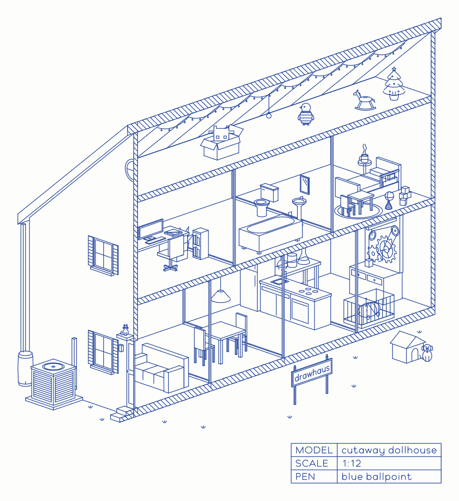
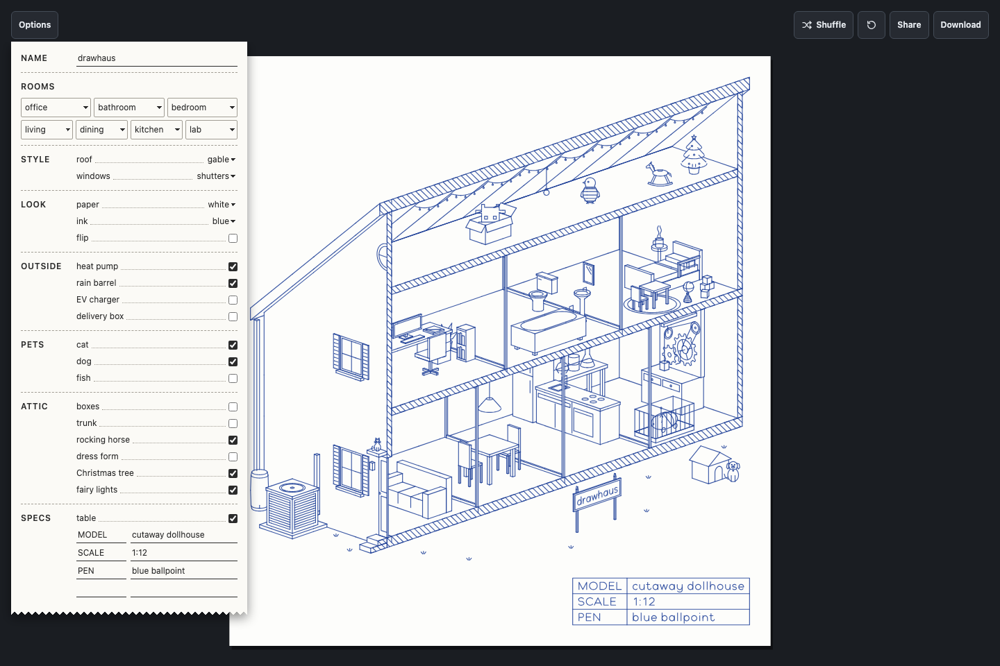

# drawhaus

Build your own cutaway dollhouse, and a blue ballpoint pen draws it.



By Andrea Antal. The name is draw + haus, a pun on dollhouse.

## What a player can do

- Choose a room for each of the 7 slots: 4 on the ground floor and 3 upstairs.
- Put a name on the welcome sign.
- Choose the roof, the windows, things outside, pets and things in the attic.
- Choose the paper and the ink, and flip the house so the door end is on the right.
- Add a spec table under the drawing, like the title block on a blueprint.
- Shuffle for a random house, share the link (the whole house is in the URL), or download a PNG.

Every house takes 7 seconds to draw.



## Run it

drawhaus is one HTML file with no build step. Serve the folder and open it in a browser:

```sh
python3 -m http.server 8010 --bind 127.0.0.1
```

Then open http://127.0.0.1:8010.

## Files

- `index.html`: the drawing engine (`<script id="house">`) and the page.
- `glyphs.js`: the pen paths of Plotline, the font the pen writes with.
- `api/drawhaus.mjs`: the Describe function (off, see below).
- `render.js`: saves pictures of houses in `renders/`. Run `node render.js`. It needs Google Chrome.
- `CLAUDE.md`: the build notes and the lessons learned.

## Tests

```sh
pnpm install
node --test
```

The tests for Describe use a stand-in for Claude, so they make no API calls.

## Describe (turned off)

Describe lets a player type a home in their own words. Claude picks the rooms, roof, windows and extras from drawhaus's own parts, and the pen draws the house. Claude only chooses parts, so the drawing is always drawhaus's own.

The function is in `api/drawhaus.mjs`, written as a [Vercel Function](https://vercel.com/docs/functions). The field on the Options receipt is turned off.

**Caution:** the function has no per-player rate limit. The spend limit on its workspace is the only cap. Set the limit before you add the key.

To turn Describe on:

1. In `index.html`, set `const DESCRIBE = true`.
2. Deploy the folder to Vercel, with `api/drawhaus.mjs` in the project's `api/` folder.
3. In the [Claude Console](https://platform.claude.com/settings/workspaces), create a workspace for drawhaus.
4. Select the workspace, click **Spend limits**, and set a monthly limit.
5. Create an API key in that workspace.
6. In Vercel, add the key as the environment variable `ANTHROPIC_API_KEY`, with type **Secret**.
7. Redeploy. A new variable applies only to new deployments.

The field shows only when `GET /api/drawhaus` answers 204, which means a key is set. Each prompt calls Claude Haiku 5.5.

## License

- The code is under the MIT License. See `LICENSE`.
- Plotline, the font in `glyphs.js`, is under the SIL Open Font License 1.1. See `OFL.txt`.
